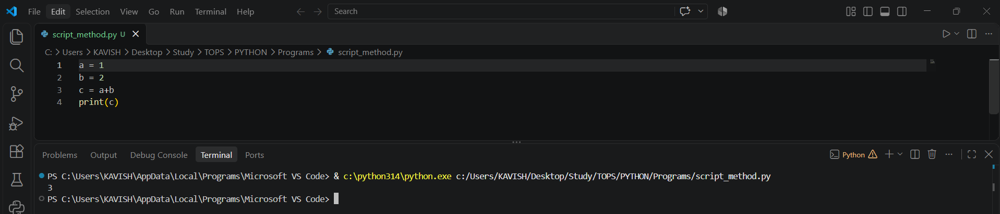

<div align="center">

# 🐍✨ Python

> **Python is a high-level, general-purpose programming language** known for its simple syntax, readability, and ease of learning.

### 👨‍💻 Created by Guido van Rossum | 📅 First Released in 1991

</div>
📌 About Python

| ✨ | Details |
|---|---|
| 🟢 | Python is **open-source** and freely available. |
| 🔤 | It is a **dynamically/vercitle typed** language. |
| 📖 | Python has a simple and readable syntax. |
| 📄 | Python programs use the **.py** file extension. |
| 🧩 | Python supports **procedural, object-oriented, and functional programming**. |

---

## 🚀 Uses of Python

Python is widely used in many fields:

| # | 💡 Field | 🛠️ Examples / Technologies |
|---:|---|---|
| 1 | 🌐 **Web Development** | Django, Flask, FastAPI |
| 2 | 📊 **Data Analysis** | NumPy, Pandas |
| 3 | 🔬 **Data Science** | NumPy, Pandas, SciPy |
| 4 | 🤖 **Artificial Intelligence & Machine Learning** | Scikit-learn, Keras, Linear Regression |
| 5 | ⚙️ **Automation & Scripting** | Python Scripts, Task Automation |
| 6 | 💻 **Software Development** | Desktop & Application Development |
| 7 | 🧪 **Scientific Computing** | SciPy, NumPy |
| 8 | 🛡️ **Cybersecurity** | Security Tools & Automation |

---

## 💻 Simple Python Example

```python
print("Hello, World!")
```

**📤 Output**

```text
Hello, World!
```

---

## 🐍 Ways to Run Python

Python programs can be executed in different environments:

> 🔹 **Python Interpreter**  
> 🔹 **VS Code**  
> 🔹 **Python IDLE**  
> 🔹 **Jupyter Notebook**  
> 🔹 **Command Prompt / Terminal**

---

## 🐍 REPL

**REPL** stands for:

> 🔹 **R** = Read  
> 🔹 **E** = Evaluate  
> 🔹 **P** = Print  
> 🔹 **L** = Loop

### ⚠️ Disadvantages

> 🔹 Run on CMD
>
> 🔹 Does not store any backup
>
> 🔹 How to start in CMD: run `python`

Example:

```text
>>> name = 'brijesh'
>>> print(name)
brijesh
>>> a = 10
>>> b = 20
>>> print("additions of numbers is :", c)
Traceback (most recent call last):
File "<python-input-4>", line 1, in <module>
print("additions of numbers is :",c)
    ^
NameError: name 'c' is not defined
>>> print("additions of numbers is :", a + b)
additions of numbers is : 30
>>> name = input('enter your age:')
enter your age:25
>>> print(name)
25
>>>

>>> age = 18
>>> if age >= 18:
...     print('i am adult')
...     else:
...         print('i am child')
...
  File "<python-input-9>", line 3
    else:
    ^^^^
SyntaxError: invalid syntax
>>> if age>=18:
...     print('i am adult')
... else:
...     print('i am child')
...
i am adult
>>> for i in range(1, 6):
...     print(i)
...
1
2
3
4
5
>>>
```

---

## 📜 Script Method



> 🔹 Script method is used to create a file with `.py`.
>
> 🔹 Script method stores backup files.
>
> 🔹 Script can also be used in the IDE Terminal.

---

## 🧮 Python Variables

> 📦 A variable is like a container where we store information about data.
>
> 🔹 A variable stores information about data.
>
> 🐍 Python is a high-level language, so variables do not need to be assigned with data types.

---

## 🧩 Python Built-in Data Types

### 📊 Data Types

| Data Type | Description | Example |
|---|---|---|
| 🔢 **Integer (`int`)** | Whole numbers | `age = 20` |
| 🔢 **Float (`float`)** | Decimal numbers | `price = 99.5` |
| 🔢 **Complex (`complex`)** | Real and imaginary parts | `number = 3 + 4j` |
| 🔤 **String (`str`)** | Text values | `name = "Kavish"` |
| ✅ **Boolean (`bool`)** | True or False | `is_passed = True` |
| 📋 **List (`list`)** | Ordered, changeable collection | `numbers = [1, 2, 3]` |
| 📦 **Tuple (`tuple`)** | Ordered, unchangeable collection | `data = (10, 20, 30)` |
| 🔹 **Set (`set`)** | Collection of unique values | `items = {1, 2, 3}` |
| 🗂️ **Dictionary (`dict`)** | Key-value pairs | `student = {"name": "Kavish", "age": 20}` |
| 🚫 **None (`NoneType`)** | Represents no value | `result = None` |

### 🧵 String Methods

| Method | Description | Example |
|---|---|---|
| `upper()` | Converts text to uppercase | `"hello".upper()` → `'HELLO'` |
| `lower()` | Converts text to lowercase | `"HELLO".lower()` → `'hello'` |
| `capitalize()` | Capitalizes the first character | `"hello bro".capitalize()` → `'Hello bro'` |
| `title()` | Capitalizes each word | `"hello bro".title()` → `'Hello Bro'` |
| `swapcase()` | Swaps letter case | `"Hello".swapcase()` → `'hELLO'` |
| `strip()` | Removes whitespace from both ends | `" hi ".strip()` → `'hi'` |
| `lstrip()` | Removes whitespace from the left | `" hi".lstrip()` → `'hi'` |
| `rstrip()` | Removes whitespace from the right | `"hi ".rstrip()` → `'hi'` |
| `replace()` | Replaces part of a string | `"hello".replace("h", "y")` → `'yello'` |
| `split()` | Splits a string into a list | `"a,b,c".split(",")` → `['a', 'b', 'c']` |
| `join()` | Joins strings using a separator | `"-".join(["a", "b"])` → `'a-b'` |
| `find()` | Finds a substring, returns -1 if absent | `"hello".find("l")` → `2` |
| `index()` | Finds a substring, raises an error if absent | `"hello".index("e")` → `1` |
| `count()` | Counts substring occurrences | `"banana".count("a")` → `3` |
| `startswith()` | Checks the starting text | `"hello".startswith("he")` → `True` |
| `endswith()` | Checks the ending text | `"hello".endswith("lo")` → `True` |
| `isalpha()` | Checks whether all characters are letters | `"hello".isalpha()` → `True` |
| `isdigit()` | Checks whether all characters are digits | `"123".isdigit()` → `True` |
| `isalnum()` | Checks for letters or digits only | `"abc123".isalnum()` → `True` |
| `isspace()` | Checks whether all characters are whitespace | `"   ".isspace()` → `True` |
| `center()` | Centers text within a width | `"hi".center(6, "-")` → `'--hi--'` |
| `zfill()` | Pads the left side with zeros | `"42".zfill(5)` → `'00042'` |

> 💡 **Note:** Strings are immutable, so these methods do not change the original string in place.

### 📋 List Methods

| Method | Description | Example |
|---|---|---|
| `append()` | Adds one item to the end | `numbers.append(40)` |
| `extend()` | Adds items from another iterable | `numbers.extend([40, 50])` |
| `insert()` | Adds an item at a position | `numbers.insert(1, 15)` |
| `remove()` | Removes the first matching value | `numbers.remove(20)` |
| `pop()` | Removes and returns an item; last by default | `numbers.pop()` |
| `clear()` | Removes all items | `numbers.clear()` |
| `index()` | Finds the first matching item's position | `numbers.index(20)` |
| `count()` | Counts occurrences of a value | `numbers.count(20)` |
| `sort()` | Sorts the list in place | `numbers.sort()` |
| `reverse()` | Reverses the list in place | `numbers.reverse()` |
| `copy()` | Returns a shallow copy | `numbers.copy()` |

---

## 🧾 Rules to Define Variables

> We cannot use reserve key words to assign a variable
>
> we cannot start a variable with nummber.
>
> we use special smbol (i.e only '_' underscore can be used)

### 💡 Example

we cannot take white space with variable

```python
a = 10
b = 20
c = "hi"
d = 'hey brijesh'
e = '''
i am brijesh 
done Mtech
'''
# single line comment
# print is inbuilt function that can print user values 
print(e)
```

---

## 🖥️ Creating a Windows Application

```python
import tkinter as tk
# create a windows screen 
root = tk.Tk()
# create a title of windows app 
root.title('vaidehi notepad app')
# create a geometry
root.geometry('550x468')
# print windows app 
tk.mainloop()
```

---

## ⭐ Why Learn Python?

Python is popular because it is:

- 🎯 **Easy to Learn**
- ✍️ **Easy to Read and Write**
- 🔄 **Versatile**
- 🌍 **Open-Source**
- 👥 **Supported by a Large Community**
- 📚 **Rich in Libraries and Frameworks**

> 💡 Python is especially useful for beginners because its syntax is clean and relatively close to natural language.

---

## 📄 Python File Extension

> 🐍 Python source files use the **`.py`** extension.

---

## 💬 Comments in Python

Comments are used to add explanations or notes to Python code. They are ignored during normal program execution.

### 🔹 Single-Line Comment

A single-line comment starts with the `#` symbol.

ctrl + ? shortcut for making all comment

```python
# Hello World
print("Hello World")
```

### 🔹 Multi-Line Comments

Python does not have a dedicated multi-line comment syntax. Triple-quoted strings are commonly used for multi-line documentation or text blocks.

```python
'''
Hello World
This is a multi-line text block.
'''
```

> 💡 **Note:** For functions, classes, and modules, triple-quoted strings are commonly used as **docstrings**.

---

## 🧩 Python Functions

> 🔹 A **function** is a reusable block of code that performs a specific task.
>
> 🔹 Functions help reduce repetition and make programs easier to understand, organize, and maintain.

### 📚 Defining and Calling a Function

- **Defining a function:** Use the `def` keyword followed by the function name and parentheses.
- **Calling a function:** Write the function name followed by parentheses to execute it.

**💡 Example**

```python
# Function definition
def greet():
    print("Hello, Python!")

# Function call
greet()
```

**📤 Output**

```text
Hello, Python!
```

### 📥 Parameters and Arguments

> 🔹 **Parameters** are variables written in the function definition.
>
> 🔹 **Arguments** are the actual values passed when the function is called.

```python
def greet(name):          # name is a parameter
    print("Hello", name)

greet("Kavish")           # "Kavish" is an argument
```

**📤 Output**

```text
Hello Kavish
```

### 🧰 Types of Functions

Python functions can be grouped into two main types:

1. 🐍 **Built-in Functions:** Functions already provided by Python, such as `print()`, `input()`, `len()`, and `type()`.
2. 👨‍💻 **User-Defined Functions:** Functions created by the programmer using the `def` keyword.

**💡 Example**

```python
# Built-in function
numbers = [10, 20, 30]
print(len(numbers))

# User-defined function
def greet():
    print("Hello, Python!")

greet()
```

**📤 Output**

```text
3
Hello, Python!
```

### 🔁 How Arguments Are Passed to Functions

> 🔹 **Call by Value** and **Call by Reference** are two common terms used to explain how values are passed to functions.
>
> 🔹 In Python, arguments are passed by object reference (also called call by sharing). A function receives a reference to the same object.
>
> 🔹 If a mutable object, such as a list, is changed inside a function, that change can be seen outside the function. Reassigning a parameter does not replace the caller's variable.

**💡 Example**

```python
def update_list(items):
    items.append(40)

def change_number(number):
    number = 100

numbers = [10, 20, 30]
value = 50

update_list(numbers)
change_number(value)

print(numbers)
print(value)
```

**📤 Output**

```text
[10, 20, 30, 40]
50
```

> 💡 **Note:** Python is not strictly call by value or call by reference. It uses object-reference passing, so the effect depends on whether the object is mutable or immutable.

### ↩️ Return Statement

> 🔹 The `return` statement sends a result back from a function to the place where it was called.

```python
def add(a, b):
    return a + b

result = add(10, 20)
print(result)
```

**📤 Output**

```text
30
```

### ♻️ Reusability of Functions

> 🔹 A function can be called multiple times in a program.
>
> 🔹 Write the code once and reuse it whenever required by calling the function.

```python
def square(number):
    return number * number

print(square(2))
print(square(5))
print(square(8))
```

**📤 Output**

```text
4
25
64
```

> 💡 **Note:** A function runs when it is called. Defining a function alone does not execute its body.

---

## 📦 What is Module?

> 🧩 A **module** is a Python file (`.py`) that contains reusable code, such as functions, variables, and classes.
>
> ♻️ Modules help organize code and allow it to be reused in other Python programs.

### 🔹 Types of Modules

1. 👨‍💻 **User-Defined Modules** = Modules created by the programmer.

2. 🐍 **Built-in Modules** = Modules provided with Python, such as `math`, `random`, and `calendar`.

3. 📦 **Third-Party Modules** = Modules or packages created by others and installed when needed, commonly using `pip`.

### ♻️ Reusability of a Module Using `import`

> 🔹 The `import` statement loads a module so that its functions and other definitions can be used in another Python file.
>
> 🔹 This avoids writing the same code again.

### 🏷️ Import Aliases Using `as`

> 🔹 The `as` keyword is used to give a shorter or different name (alias) to an imported module.
>
> 🔹 This alias can then be used to access the module's functions and other definitions.

**💡 Example**

```python
import pandas as pd

data = {
    "name": ["Amit", "Riya", "Kavish"],
    "age": [20, 21, 20]
}

df = pd.DataFrame(data)
print(df)
```

**📤 Output**

```text
     name  age
0    Amit   20
1    Riya   21
2  Kavish   20
```

> 💡 **Note:** Here, `pd` is the alias for the `pandas` module. The same module can be accessed using `pd` instead of writing `pandas` each time.

### 💡 Example: Creating a Module with a Function

Create a file named **mymodule.py**:

```python
# mymodule.py

def greet(name):
    print("Hello", name)

def add(a, b):
    return a + b
```

Create another file in the same folder named **main.py**:

```python
# main.py

import mymodule

mymodule.greet("Kavish")
result = mymodule.add(10, 20)

print(result)
```

**📤 Output**

```text
Hello Kavish
30
```

### 🔍 Understanding the Example

| Code | Explanation |
|---|---|
| `import mymodule` | Imports the user-defined module. |
| `mymodule.greet("Kavish")` | Calls the `greet()` function from the module. |
| `mymodule.add(10, 20)` | Calls the `add()` function and receives its returned result. |
| `print(result)` | Displays the returned value. |

> 💡 **Note:** Keep `mymodule.py` and `main.py` in the same folder for this example.

### 🐍 Examples of Built-in Modules

```python
# math module
import math
print(math.pow(5, 2))

# random module
import random
print(random.randint(1, 10))

# calendar module
import calendar
print(calendar.month(2026, 9))

# datetime module
import datetime
print(datetime.datetime.now())

# sys module
import sys
print(sys.version)
```

### 📦 What is pip?

> 🔹 **pip** stands for Python Package Installer.
>
> 🔹 It is used to install and manage third-party packages.

```bash
pip install package_name
```


---

## 🧪 Virtual Environments

### 1. What is a Virtual Environment?

A **virtual environment** is an isolated Python environment for a particular project. It keeps that project's installed packages separate from packages used by other projects.

Developers use virtual environments to:
- Keep project dependencies separate.
- Avoid conflicts between package versions.
- Recreate the same package setup when working on another computer.

### 2. Why Do We Need It?

Different projects may need different versions of the same package.

For example:
- **Project A** may need an older version of a package.
- **Project B** may need a newer version.

Installing everything into one shared Python environment can cause version conflicts. A separate virtual environment lets each project use the package versions it needs.

### 3. Creating a Virtual Environment

Open a terminal in your project folder and run:

```bash
python -m venv venv
```

This creates a folder named `venv` containing the isolated environment for that project.

### 4. Activating on Windows (Command Prompt)

In Windows Command Prompt, run:

```bat
venv\Scripts\activate
```

When the environment is active, its name usually appears at the beginning of the terminal prompt:

```text
(venv) C:\path\to\your\project>
```

### 5. Deactivating

To leave the active virtual environment, run:

```bash
deactivate
```

This returns the terminal to the normal Python environment.

### 6. Installing Packages

Activate the environment first. Then install packages using `pip`.

For example, to install NumPy:

```bash
pip install numpy
```

The package is installed in the active virtual environment rather than being added to every Python project on your computer.

### 7. Deleting an Environment

A virtual environment can be safely removed when it is no longer needed.

1. Run `deactivate` if the environment is currently active.
2. Delete the project's `venv` folder.
3. To create it again, run:

```bash
python -m venv venv
```

Deleting the `venv` folder removes that environment and its installed packages. It does not delete your project files or uninstall the main Python installation.

### 8. Using `.gitignore`

A virtual environment contains many generated files and can be large. It should generally not be uploaded to GitHub.

Add the following entries to the repository's `.gitignore` file:

```gitignore
# Python virtual environments
venv/
.venv/
**/venv/
**/.venv/

# Python cache files
__pycache__/
*.py[cod]
```

Keep your source code and project files in GitHub. Other developers can create their own virtual environment on their computers.

> 💡 **Remember:** A virtual environment is separate from the actual Python installation. Python itself must be installed on your computer; the virtual environment uses that Python installation to create an isolated place for project-specific packages. In VS Code, select the project's virtual environment as the Python interpreter so the editor and terminal use the correct environment.

---

## ⚙️ Operators

> 🔹 Operators are used to perform actions on values.
>
> 🔹 **Operand** = The value on which an operator works.

### 🔢 1. Arithmetic Operators

| Operator | Example | Meaning |
|---|---|---|
| `+` | `5 + 2` | Addition |
| `-` | `5 - 2` | Subtraction |
| `*` | `5 * 2` | Multiplication |
| `/` | `5 / 2` | Division |
| `%` | `5 % 2` | Remainder |
| `**` | `5 ** 2` | Power |
| `//` | `5 // 2` | Floor division |

### 📝 2. Assignment Operators

| Operator | Example | Meaning |
|---|---|---|
| `=` | `x = 5` | Assign |
| `+=` | `x += 2` | Add & assign |
| `-=` | `x -= 2` | Subtract & assign |
| `*=` | `x *= 2` | Multiply & assign |
| `%=` | `x %= 2` | Remainder & assign |

### ⚖️ 3. Comparison Operators

| Operator | Example | Meaning |
|---|---|---|
| `>` | `5 > 2` | Greater than |
| `<` | `5 < 2` | Less than |
| `>=` | `5 >= 2` | Greater/equal |
| `<=` | `5 <= 2` | Less/equal |
| `==` | `5 == 5` | Equal |
| `!=` | `5 != 2` | Not equal |

### 🧠 4. Logical Operators

| Operator | Example | Meaning |
|---|---|---|
| `and` | `True and False` | Both true |
| `or` | `True or False` | Either true |
| `not` | `not True` | Reverses result |

### 💾 5. Bitwise Operators

| Operator | Example | Meaning |
|---|---|---|
| `&` | `5 & 3` | AND |
| `|` | `5 | 3` | OR |
| `^` | `5 ^ 3` | XOR |
| `~` | `~5` | NOT |
| `<<` | `5 << 1` | Left shift |
| `>>` | `5 >> 1` | Right shift |

### 🪪 6. Identity Operators

| Operator | Example | Meaning |
|---|---|---|
| `is` | `a is b` | Same object |
| `is not` | `a is not b` | Different object |

### 🔀 7. Conditional / Ternary Operator

| Operator | Example | Meaning |
|---|---|---|
| Ternary | `x if condition else y` | Short if-else |

### 🔎 8. Membership Operators

| Operator | Example | Meaning |
|---|---|---|
| `in` | `2 in [1, 2]` | Exists in sequence |
| `not in` | `3 not in [1, 2]` | Does not exist in sequence |

### 🔄 9. Increment / Decrement Operators

| Operator | Example | Meaning |
|---|---|---|
| `++` | `x++` | Increment |
| `--` | `x--` | Decrement |

> ⚠️ **Note:** Python does **not** support `++` or `--` operators.
>
> 🔹 Use `x += 1` to increment.  
> 🔹 Use `x -= 1` to decrement.

---

## 📌 Python Statements

> 🐍 Statements are instructions used to perform operations, make decisions, and control the flow of a Python program.

### 📚 Types of Statements

### 🔀 1. Conditional Statements

> Used to execute different blocks of code depending on whether a condition is true or false.

| Statement | Definition |
|---|---|
| `if` | Executes a block when the condition is true. |
| `if-else` | Chooses between two blocks of code. |
| `if-elif-else` | Checks multiple conditions in order. |
| `Nested-if` | An `if` statement placed inside another `if` statement to check an additional condition. |
| `switch-case` | Python does not have a traditional switch-case statement. The `match-case` statement provides similar functionality (Python 3.10+). |

**💡 Examples**

```python
# if
age = 18
if age >= 18:
    print("Adult")

# if-else
if age >= 18:
    print("Adult")
else:
    print("Minor")

# if-elif-else
marks = 75
if marks >= 90:
    print("Grade A")
elif marks >= 60:
    print("Grade B")
else:
    print("Needs improvement")

# Nested-if
age = 20
has_id = True
if age >= 18:
    if has_id:
        print("Entry allowed")
    else:
        print("ID required")
else:
    print("Under age")

# match-case (Python 3.10+)
day = 2
match day:
    case 1:
        print("Monday")
    case 2:
        print("Tuesday")
    case _:
        print("Invalid day")
```

### 🔁 2. Looping Statements

> Loops are used to execute a block of code repeatedly. They reduce repeated code and make programs easier to manage.

### 📚 Types of Loops

| Loop | Definition |
|---|---|
| `for` loop | Repeats a block of code for each item in a sequence or iterable. |
| `while` loop | Repeats a block of code as long as the given condition is true. |
| `Nested` loop | A loop written inside another loop. |

**💡 Examples**

```python
# 1. for loop
for number in range(1, 4):
    print(number)

# 2. while loop
count = 1
while count <= 3:
    print(count)
    count += 1

# 3. Nested for loop
for row in range(1, 3):
    for column in range(1, 4):
        print(row, column)
```

### 🧰 Useful Loop Concepts

| Concept | Explanation |
|---|---|
| `range()` | Generates a sequence of numbers, commonly used with a `for` loop. |
| `break` | Stops the loop immediately. |
| `continue` | Skips the current iteration and continues with the next one. |
| `else` | Runs after a loop finishes normally, but not when it ends with `break`. |

**💡 Examples**

```python
# range(start, stop, step)
for number in range(1, 6, 2):
    print(number)

# loop with else
for number in range(1, 4):
    print(number)
else:
    print("Loop completed")
```

> 💡 **Note:** In `range(start, stop, step)`, the stop value is not included.

### 🎮 3. Control Flow Statements

> Used to alter the normal execution of loops or leave a block of code empty temporarily.

| Statement | Definition |
|---|---|
| `break` | Immediately exits the nearest loop. |
| `continue` | Skips the current iteration and moves to the next one. |
| `pass` | Does nothing; acts as a placeholder where a statement is required. |

**💡 Examples**

```python
# break
for number in range(1, 6):
    if number == 3:
        break
    print(number)

# continue
for number in range(1, 4):
    if number == 2:
        continue
    print(number)

# pass
for number in range(1, 4):
    if number == 2:
        pass
    print(number)
```

## 🧱 What are Data Structures in Python?

> 📦 Data structures are used to organising, storing, managing and accessing data in a computer program so that we can perform operations efficiently.

### ⭐ Advantages of Data Structures

1. Store multiple values in a single variable.
2. Store data efficiently.
3. Update, append, or remove data.
4. Search and sort data.
5. Organize large amounts of data efficiently.
6. Access data using an index or key.
7. Perform slicing on supported data structures.
8. Create a structured data format.

### 📚 Types of Data Structures in Python

1. **String:** Provides immutable elements.
2. **Dictionary:** Provides mutable elements.
3. **List:** Provides mutable elements.
4. **Tuple:** Provides immutable elements.
5. **Set:** Stores unique elements and is mutable.

> 💡 **Note:** The set is mutable as a collection, but its individual elements must be immutable (hashable). Sets do not have indexes.

---

## 🔢 Python Arrays

> 📦 An **array** is a data structure used to store multiple values in an organized way.
>
> 🐍 In Python, arrays for numerical and scientific computing are commonly created using the third-party library **NumPy**.
>
> 🔹 NumPy provides powerful tools for working with numerical data and creating arrays.

### ⚙️ How to Install NumPy

> 🔹 NumPy can be installed using Python's package installer, `pip`.
>
> 🔹 After installation, import NumPy into your program and check its version to confirm it is available.

**💡 Steps**

1. **Install NumPy** using the terminal:

```bash
python -m pip install numpy
```

2. **Import NumPy** in your Python program:

```python
import numpy as np
```

3. **Check the installed version:**

```python
print(np.__version__)
```

4. **View package details** in the terminal:

```bash
python -m pip show numpy
```

> 💡 **Note:** Run installation and package-information commands in the terminal. Run the `import` and version-check statements inside a Python program or interpreter.

### 📚 Arrays Using NumPy

> 🔹 **NumPy** is a third-party Python library used for numerical computing.
>
> 🔹 It provides support for creating and working with arrays.

### 🔠 Specifying Data Types in NumPy Arrays

> 🔹 NumPy allows you to specify the data type of array elements using the `dtype` parameter.
>
> 🔹 For example, `dtype=int` creates an array with integer elements.

**💡 Example**

```python
import numpy as np

# Integer array
arr = np.array([1, 2, 3, 4, 5, 6, 7, 8, 9], dtype=int)
res = np.array(arr)

print(res)
```

**📤 Output**

```text
[1 2 3 4 5 6 7 8 9]
```

> 💡 **Note:** To set the data type directly, pass the list and `dtype` as arguments to `np.array()`, like this: `np.array([1, 2, 3], dtype=int)`.

### 📏 Types of Arrays Based on Dimensions

| Array Type | Explanation |
|---|---|
| **0-D Array** | An array containing a single value, also called a scalar. |
| **1-D Array** | A one-dimensional collection of values, arranged in a single sequence. |
| **2-D Array** | Values arranged in rows and columns, like a table or matrix. |
| **N-D Array** | An array with two or more dimensions. |

### 💡 Examples Using NumPy

First, install NumPy if it is not already installed:

```bash
pip install numpy
```

Import NumPy in your Python program:

```python
import numpy as np
```

### 🔍 Creating an Array and Accessing Elements (Indexing)

> 🔹 A Python list can be converted into a NumPy array using `np.array()`.
>
> 🔹It is a Third Party module so we have to install it
>
> 🔹 Use `type()` to check the object's type and an index inside square brackets to access an individual element.
>
> 🔹 Array indexing starts from `0`, so the first element is at index `0`.

**💡 Example**

```python
import numpy as np

arr = [1, 2, 3, 4, 5, 6, 7, 8, 9]
res = np.array(arr)

print(res)
print(type(res))

print(res[0])  # Indexing
print(res[1])  # Indexing
print(res[2])  # Indexing
print(res[3])  # Indexing
print(res[4])  # Indexing
```

**📤 Output**

```text
[1 2 3 4 5 6 7 8 9]
<class 'numpy.ndarray'>
1
2
3
4
5
```

---

**1. 0-D Array**

```python
import numpy as np

arr = np.array(10)
print(arr)
```

**📤 Output**

```text
10
```

**2. 1-D Array**

```python
import numpy as np

arr = np.array([10, 20, 30])
print(arr)
```

**📤 Output**

```text
[10 20 30]
```

**3. 2-D Array**

```python
import numpy as np

arr = np.array([[1, 2, 3], [4, 5, 6]])
print(arr)
```

**📤 Output**

```text
[[1 2 3]
 [4 5 6]]
```

**4. N-D Array**

> 🔹 NumPy can also create arrays with three or more dimensions by nesting lists.

```python
import numpy as np

arr = np.array([[[1, 2], [3, 4]],
                [[5, 6], [7, 8]]])

print(arr)
```

**📤 Output**

```text
[[[1 2]
  [3 4]]

 [[5 6]
  [7 8]]]
```

> 💡 **Note:** The number of dimensions of a NumPy array can be checked using `arr.ndim`.

---

## 🧱 Python Data Structures

### 🔤 1. Strings

> 🔹 A **string** is a sequence of characters enclosed in single quotes (`''`) or double quotes (`""`).
>
> 🔹 Strings are **immutable**, which means their characters cannot be changed after the string is created.
>
> 🔹 Triple quotes can be used to create a multi-line string.

**💡 Example**

```python
# Single and double quotes
name = 'Python'
message = "Learning Python is fun!"

# Multi-line string
details = """
Python is easy to learn.
It is used in many fields.
"""

print(name)
print(message)
print(details)
print(type(name))
```

**📤 Output**

```text
Python
Learning Python is fun!

Python is easy to learn.
It is used in many fields.

<class 'str'>
```

### ✂️ String Slicing

> 🔹 Slicing is used to access a part of a string.
>
> 🔹 The syntax is `string[start:stop:step]`. The stop position is not included.
>
> 🔹 Negative indexing can be used to access characters from the end of a string.

**💡 Example**

```python
text = "PYTHON"

print(text[0:3])
print(text[::1])
print(text[::-1])
print(text[-3:])
```

**📤 Output**

```text
PYT
PYTHON
NOHTYP
HON
```

> 💡 **Note:** String methods such as `upper()`, `lower()`, `capitalize()`, `find()`, and `count()` are covered in the String Methods table above.

### 🗂️ 2. Dictionaries

> 🔹 A **dictionary** stores data in **key-value pairs** using curly brackets (`{}`).
>
> 🔹 A dictionary is mutable, so items can be added, changed, or removed.
>
> 🔹 Values can contain different data types, including lists and other dictionaries.
>
> 🔹 A dictionary can also be created using the `dict()` constructor.

**💡 Example: Creating a Dictionary**

```python
student = {
    "name": "Kavish",
    "age": 20,
    "course": "Python"
}

print(student)
print(type(student))
print(student["name"])
print(student["age"])
```

**📤 Output**

```text
{'name': 'Kavish', 'age': 20, 'course': 'Python'}
<class 'dict'>
Kavish
20
```

**💡 Example: Using the `dict()` Constructor**

```python
student = dict(name="Kavish", age=20, course="Python")
print(student)
```

**📤 Output**

```text
{'name': 'Kavish', 'age': 20, 'course': 'Python'}
```

### 🛠️ Dictionary Operations

| Operation | Description | Example |
|---|---|---|
| Access | Gets a value using its key | `student["name"]` |
| Add | Adds a new key-value pair | `student["city"] = "Vadodara"` |
| Update | Changes an existing value | `student["age"] = 21` |
| `keys()` | Returns all keys | `student.keys()` |
| `values()` | Returns all values | `student.values()` |
| `items()` | Returns key-value pairs | `student.items()` |
| `pop()` | Removes the item with the given key | `student.pop("course")` |
| `clear()` | Removes all items | `student.clear()` |
| `update()` | Adds or updates key-value pairs | `student.update({"age": 22})` |

**💡 Example: Adding, Updating, and Iterating**

```python
student = {"name": "Kavish", "age": 20}

student["city"] = "Vadodara"
student.update({"age": 21})

for key, value in student.items():
    print(key, value)
```

**📤 Output**

```text
name Kavish
age 21
city Vadodara
```

### 🔀 Nested Data Structures

> 🔹 A dictionary can store a list as a value. This is useful when one key needs to hold multiple related values.

**💡 Example**

```python
employee = {
    "name": ["Amit", "Riya", "Kavish"],
    "age": [22, 21, 20]
}

print(employee["name"])
print(employee["age"])
print(employee["name"][2])
```

**📤 Output**

```text
['Amit', 'Riya', 'Kavish']
[22, 21, 20]
Kavish
```

### 📋 3. Lists

> 🔹 A **list** stores multiple values in an ordered collection.
>
> 🔹 Lists are mutable, which means their elements can be changed, added, or removed.
>
> 🔹 Lists are created using square brackets (`[]`) or the `list()` constructor.
>
> 🔹 List indexing starts from `0`.

**💡 Example: Creating and Accessing a List**

```python
numbers = [10, 20, 30, 40]

print(numbers)
print(type(numbers))
print(numbers[0])
print(numbers[-1])
```

**📤 Output**

```text
[10, 20, 30, 40]
<class 'list'>
10
40
```

**💡 Example: Using the `list()` Constructor**

```python
numbers = list((10, 20, 30))
print(numbers)
```

**📤 Output**

```text
[10, 20, 30]
```

### ✂️ List Slicing and Updating

> 🔹 Slicing is used to access a range of list elements.
>
> 🔹 Since lists are mutable, an element can be changed by assigning a new value to its index.

**💡 Example**

```python
numbers = [10, 20, 30, 40, 50]

print(numbers[1:4])
print(numbers[::-1])

numbers[1] = 25
print(numbers)
```

**📤 Output**

```text
[20, 30, 40]
[50, 40, 30, 20, 10]
[10, 25, 30, 40, 50]
```

> 💡 **Note:** Common list methods such as `append()`, `extend()`, `insert()`, `remove()`, and `pop()` are covered in the List Methods table above.

### 📦 4. Tuples

> 🔹 A **tuple** stores multiple values in an ordered collection.
>
> 🔹 Tuples are **immutable**, which means their elements cannot be changed after creation.
>
> 🔹 Tuples are created using parentheses (`()`) or the `tuple()` constructor.

**💡 Example: Creating and Accessing a Tuple**

```python
student = ("Kavish", 20, "Python")

print(student)
print(type(student))
print(student[0])
print(student[-1])
```

**📤 Output**

```text
('Kavish', 20, 'Python')
<class 'tuple'>
Kavish
Python
```

**💡 Example: Using the `tuple()` Constructor**

```python
numbers = tuple([10, 20, 30])
print(numbers)
```

**📤 Output**

```text
(10, 20, 30)
```

> ⚠️ **Note:** You can access tuple elements using indexing and slicing, but you cannot assign a new value to an existing tuple position.

### 🔹 5. Sets

> 🔹 A **set** is a collection of unique values.
>
> 🔹 Sets are mutable, so values can be added or removed. However, individual elements do not have fixed positions, so sets do not support indexing.
>
> 🔹 Sets are created using curly brackets (`{}`) or the `set()` constructor.
>
> 🔹 An empty set must be created using `set()`, because `{}` creates an empty dictionary.

**💡 Example: Creating a Set**

```python
numbers = {10, 20, 20, 30, 40}

print(numbers)
print(type(numbers))
```

**📤 Output**

```text
{10, 20, 30, 40}
<class 'set'>
```

> 💡 **Note:** Set elements are unique, so duplicate values are automatically removed. The display order of set elements is not guaranteed.

### 🛠️ Common Set Operations

| Method | Description | Example |
|---|---|---|
| `add()` | Adds one value | `numbers.add(50)` |
| `update()` | Adds values from another iterable | `numbers.update([60, 70])` |
| `remove()` | Removes a value; raises an error if absent | `numbers.remove(20)` |
| `discard()` | Removes a value without an error if absent | `numbers.discard(20)` |
| `pop()` | Removes and returns an arbitrary element | `numbers.pop()` |
| `clear()` | Removes all elements | `numbers.clear()` |

### 🔗 Set Operations

> 🔹 Sets support mathematical operations such as union, intersection, difference, and symmetric difference.

**💡 Example**

```python
a = {1, 2, 3, 4}
b = {3, 4, 5, 6}

print(a | b)  # Union
print(a & b)  # Intersection
print(a - b)  # Difference
print(a ^ b)  # Symmetric difference
```

**📤 Output**

```text
{1, 2, 3, 4, 5, 6}
{3, 4}
{1, 2}
{1, 2, 5, 6}
```


---

## ⚖️ Difference Between List, Tuple, Dictionary, and Set

These four data structures can all store multiple values, but they organize and access those values differently.

### 🧠 First, understand the main idea

- **List `[]`**: A changeable sequence. It keeps items in order and allows duplicates.
- **Tuple `()`**: A fixed sequence. It keeps items in order and allows duplicates, but you cannot change its elements.
- **Dictionary `{key: value}`**: Stores information as key-value pairs. You look up a value using its key.
- **Set `{}`**: Stores unique values. It removes duplicates automatically and does not support indexing.

### 📊 Comparison Table

| Feature | List | Tuple | Dictionary | Set |
|---|---|---|---|---|
| Syntax | `[ ]` | `( )` | `{key: value}` | `{ }` |
| Ordered? | Yes | Yes | Yes, insertion order | No guaranteed order |
| Mutable? | Yes | No | Yes | Yes |
| Allows duplicates? | Yes | Yes | Keys: No; values: Yes | No |
| Access | Index | Index | Key | No index |
| Add / remove items? | Yes | No direct item changes | Yes | Yes |
| Slicing? | Yes | Yes | No | No |
| Best used for | Changeable sequence | Fixed sequence | Labeled information | Unique items |

> 💡 **Important:** A dictionary's keys must be unique. Its values can repeat. Set elements must be hashable, so a list or dictionary cannot be stored directly inside a set.

### 🎯 One Example That Makes Everything Click

Imagine you are building a college student record system. You want to store the students, keep a fixed student profile, save details with labels, and find the unique courses.

```python
# 1. LIST: Student names in order.
# We can add, remove, or change names.
students = ["Amit", "Riya", "Kavish", "Amit"]

# 2. TUPLE: A fixed profile for one student.
# The values stay in their original positions.
student_profile = ("Kavish", 20, "Computer Engineering")

# 3. DICTIONARY: Details with meaningful labels.
# We access each value using its key.
student_details = {
    "name": "Kavish",
    "age": 20,
    "course": "Computer Engineering"
}

# 4. SET: Unique courses in the college.
# Repeated course names are automatically removed.
courses = {"Python", "Java", "Python", "C"}

print("LIST:", students)
print("TUPLE:", student_profile)
print("DICTIONARY:", student_details)
print("Student name:", student_details["name"])
print("SET:", courses)
```

**📤 Example Output**

```text
LIST: ['Amit', 'Riya', 'Kavish', 'Amit']
TUPLE: ('Kavish', 20, 'Computer Engineering')
DICTIONARY: {'name': 'Kavish', 'age': 20, 'course': 'Computer Engineering'}
Student name: Kavish
SET: {'Python', 'Java', 'C'}
```

> 💡 **Why each one is different:**
>
> - The **list** keeps the student names in order and allows "Amit" to appear twice.
> - The **tuple** keeps the profile values in a fixed order. You can read them, but you cannot replace an element.
> - The **dictionary** gives every detail a label, so `student_details["age"]` is clearer than remembering a position.
> - The **set** keeps only one copy of each course. Its display order may vary.

### 🧪 Quick Memory Trick

- **List = Editable list of things**
- **Tuple = Fixed group of things**
- **Dictionary = Details with labels**
- **Set = Unique things only**

---

<div align="center">

### 🐍✨ Python • Learn • Build • Create ✨🐍

</div>
